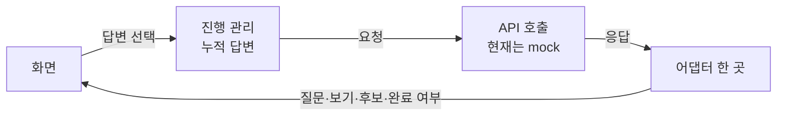
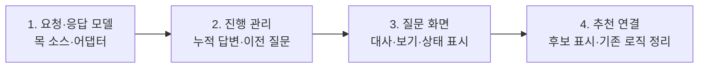
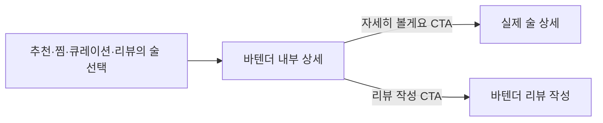

# 바텐더 시나리오 프론트엔드 설계

취향 추천을 서버가 질문을 진행하는 구조로 전환한다. **2026-10-24 대화에서 합의한 구조와 새 설계 순서**를 기록한다. Product API 계약은 아직 없으며, 목 요청·응답은 프론트 설계를 위한 가정이다.

**사용자 원칙:** 최소 기능을 만족하는 가장 단순한 구조로 시작한다. 정상 흐름에 필요한 상태·동작부터 설계하고, 기술적으로 판단할 수 있는 사항은 구체적인 제안으로 정리한다.

## 합의한 구조

답변은 질문 ID와 선택값을 순서대로 보관한다. 서버 응답은 TanStack Query가 관리한다. 프론트는 응답을 기준으로 다음 질문을 표시한다. 질문 전체를 미리 받아 프론트가 transition을 실행하는 구조는 현재 합의안이 아니다.

## 설계 순서와 변경 범위

| Phase | 해야 할 일                                                                                                       | 현재 코드의 변경 지점                                                                                                   |
| ----- | ---------------------------------------------------------------------------------------------------------------- | ----------------------------------------------------------------------------------------------------------------------- |
| 1     | 화면용 질문·답변·단계 응답을 interface로 정의. 누적 답변에 따라 다음 질문을 주는 목 소스와 단일 응답 어댑터 설계 | `_scenario/` 추가, 기존 questionnaire의 선택지 ID 보완 및 문구 공유                                                     |
| 2     | useScenarioFlow에서 답변 기록과 요청 조율. 이전 질문 조회, 답변 변경 시 이후 기록 정리, 로딩·실패·재시도 설계    | useTasteRecommendation.ts의 답변 책임 교체, useBartenderJourney.ts와 질문 진행의 경계, bartenderSnapshot.ts의 복원 범위 |
| 3     | 현재 질문의 문구·보기·입력 방식으로 화면 표시. 같은 응답에서 대사와 질문 영역의 상태 계산                        | RecommendationFlow.tsx, dialogue.ts, stepMeta.ts, BartenderExperience.tsx 연결                                          |
| 4     | 중간 후보와 최종 추천을 응답에서 표시. 취향 추천의 고정 6단계 분기·데모 추천 계산을 제거하고 관련 호출부 연결    | CandidateList.tsx, useTasteRecommendation.ts, 데모 추천 사용처, 결과 추적·상세 이동                                     |

Phase는 **설계 검토 순서**다. 각 상세 문서는 현재 코드 → 변경 → 영향 → 검증을 도식과 표로 정리하고 대화에서도 브리핑한다. 상세 설계를 하나씩 검토한 뒤 다음 문서를 작성한다. 화면과 추천이 함께 의존하는 답변 타입·복원·결과 호출부는 실제 전환 시 함께 연결되도록 구현 경계를 정한다.

목 응답의 분기와 후보 fixture는 목 소스에 둔다. Phase 4는 기존 데모 추천 점수·유사 추천 계산을 이식하지 않고 작은 fixture로 대체하는 최소안을 제안한다. 화면은 목 데이터인지 실제 서버 데이터인지에 관계없이 같은 입력을 받는다.

## 상세 설계 상태

| 문서                                                              | 상태                                         |
| ----------------------------------------------------------------- | -------------------------------------------- |
| [Phase 1 — 단계 요청·응답과 목 API](./phase-1-scenario-source.md) | 구현 완료 · 코드 검토 대기                   |
| [Phase 2 — 누적 답변과 질문 진행](./phase-2-scenario-flow.md)     | 사용자 검토 완료                             |
| [Phase 3 — 질문 화면](./phase-3-question-view.md)                 | 사용자 검토 완료                             |
| [Phase 4 — 추천 결과 연결](./phase-4-scenario-results.md)         | 내부 상세 유지·선택 경로 통일 반영 · 검토 중 |

## Phase 1의 입력·출력

| 결정      | 설계할 내용                                                                                           |
| --------- | ----------------------------------------------------------------------------------------------------- |
| 입력      | 그룹·시나리오 선택 정보와 누적 답변. 실제 Product 요청 필드명은 아직 확정하지 않음                    |
| 출력      | 현재 표시할 질문·보기, 위스키 후보, 완료 여부를 담는 화면용 모델                                      |
| 목 동작   | 빈 답변이면 첫 질문, 누적 답변이면 다음 질문 또는 완료. 목 분기는 소스 안에 둠                        |
| 변환      | 목 응답 → 화면용 모델의 단일 어댑터. 현행 질문지로 다시 변환하는 어댑터 없음                          |
| 특수 입력 | 마셔본 술 검색과 잔/병 가격 선택을 어떻게 표현할지 명시. 현재 Admin 정의에서 지원된다고 가정하지 않음 |

## 술 선택 후 이동 원칙

실제 술 상세에서 돌아오면 보던 내부 상세를 복원한다. 내부 뒤로 가기는 들어온 목록·검색으로 복귀한다.

## 연결 후 확인할 사용자 흐름

| 행동                  | 기대 결과                                |
| --------------------- | ---------------------------------------- |
| 시작하고 답변 선택    | 첫 질문 → 다음 질문 → 추천 완료          |
| 이전 질문의 답변 변경 | 이후 답변이 정리되고 새 경로·후보가 표시 |
| 요청 실패 후 재시도   | 선택한 답변을 잃지 않고 다시 요청        |
| 술 상세에 다녀오기    | 유효한 답변 기록과 화면 복원             |
| 큐레이션·리뷰·찜 진입 | 기존 진입·복귀 동작 유지                 |

상황별 큐레이션, 리뷰 작성, 찜 목록의 신규 서버 연동은 이번 설계 범위 밖이다. 기존 술 선택 경로를 내부 상세로 통일하는 연결 변경은 포함한다. 서버 캐시는 그룹 목록·공통 정의처럼 공유 가능한 데이터와 답변에 따라 달라지는 응답을 구분해 실제 API 계약 후 결정한다.

## 근거와 문서

- [백엔드 구조 대조](./backend-scenario-review.md): Admin 코드에서 확인한 사실과 Product 실행 흐름에 대한 추론.
- [Phase 1](./phase-1-scenario-source.md): 누적 답변 요청·단계 응답·목 소스·어댑터.
- [Phase 2](./phase-2-scenario-flow.md): answers 하나와 Query로 진행하는 hook, 기본적인 이전 질문 처리.
- [Phase 3](./phase-3-question-view.md): 응답의 prompt와 입력 종류로 기존 화면에 질문 표시.
- [Phase 4](./phase-4-scenario-results.md): 중간 후보 수·최종 목록, 바텐더 내부 상세·CTA 이동·복원과 데모 추천 의존 정리.
