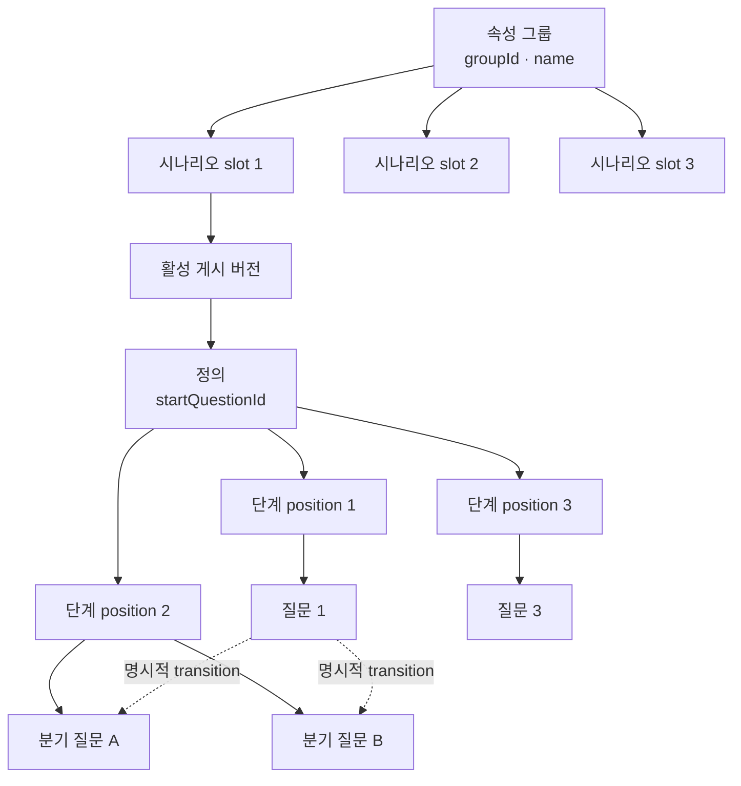
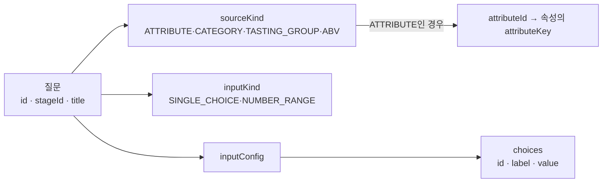
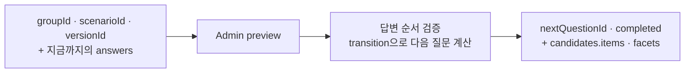
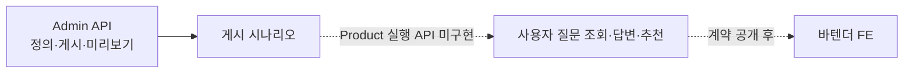

# 백엔드 시나리오 구조 대조

> **확인 기준:** 백엔드 main 7cce6fda (2026-10-23)  
> **근거:** [시나리오 정의 PR #810](https://github.com/bottle-note/bottle-note-api-server/pull/810), [구조 정리 PR #811](https://github.com/bottle-note/bottle-note-api-server/pull/811)  
> **상태:** Admin 정의·미리보기는 병합됨. Product 사용자 실행 API는 후속 작업

## 현재 백엔드의 연결 구조

**중요:** slot 1~3은 **그룹당 시나리오 자리**다. 시나리오의 단계 수 3개를 뜻하지 않는다. stage는 position으로 정렬하고, 한 stage에 여러 분기 질문이 들어갈 수 있다. 실제 이동은 배열 순서가 아니라 transition의 조건·우선순위·대상 질문으로 정한다.

| 사용자 표현 | 확인한 백엔드 필드·의미                                                                                     |
| ----------- | ----------------------------------------------------------------------------------------------------------- |
| 속성 키     | AlcoholAttribute에는 attributeKey가 있다. 시나리오 질문은 attributeKey 문자열 대신 attributeId를 참조       |
| 그룹 키     | AlcoholAttributeGroup에는 문자열 groupKey가 없다. groupId와 name으로 식별. TASTING_GROUP의 code는 별도 개념 |
| 시나리오 1  | 그룹 안의 slot=1이며, DB scenarioId와 activeVersionId가 따로 있다                                           |
| 3단계       | definition.stages의 position 1·2·3. 각 단계는 질문 하나 이상을 가질 수 있고 전환으로 건너뛸 수 있다         |

## 프론트 초안과 달라진 점

| 현재 Phase 1·2 가정                           | 백엔드 Admin 정의                                         | 설계 영향                                                     |
| --------------------------------------------- | --------------------------------------------------------- | ------------------------------------------------------------- |
| Scenario = id + 평면 questions                | groupId/slot/activeVersion + stages/questions/transitions | 시나리오 선택, 단계, 분기 관계를 별도 모델로 검토             |
| 질문 ID = level/likes/kind 등 문자열          | 질문 ID와 stage ID는 숫자, title은 표시 문구              | step 이름을 서버 ID로 취급하지 않음                           |
| optionGroups = default/american, glass/bottle | 질문별 inputConfig.choices. 그룹별 보기 묶음 필드는 없음  | 대안 질문과 transition으로 표현되는지 확인                    |
| single-choice/alcohol-multi/price             | SINGLE_CHOICE, NUMBER_RANGE                               | likes의 술 검색·가격 단위 UI는 아직 정의에 직접 대응하지 않음 |
| prompt, option description, group label       | 질문 title, 보기 id/label/value                           | 없는 설명·그룹 문구를 서버 필드로 가정하지 않음               |
| 질문 배열 순서대로 6단계                      | startQuestionId + 조건/priority가 있는 transitions        | 다음 질문과 진행률을 고정 배열로 계산하는 설계 재검토         |

선택지 id와 실제 검색 값 value도 구분된다. 답변은 표시 문구 대신 questionId + kind + choiceId 또는 숫자 범위로 표현된다. 조건은 choiceId를 비교하며, 같은 속성을 여러 질문에서 재사용할 수 있다.

## API 현황과 설계 판단

### Admin 미리보기에서 확인한 실행 흐름

Admin 미리보기 요청은 그룹·시나리오·버전 경로와 답변 배열을 받는다. 선택형 답변은 questionId와 choiceId를 담고, 서버가 유효한 경로를 따라 nextQuestionId를 계산한다. 선택적인 viewQuestionId를 주면 그 질문 **직전까지의 답변**으로 후보 위스키·집계를 계산한다. 응답의 candidates에는 items, totalCount, facets가 있다. 단계 position은 이 미리보기 요청의 입력값이 아니다.

따라서 Product 화면에서 **groupId + 현재 단계 + 고른 답변을 보내고 다음 질문과 중간 후보 정보를 받는 흐름**은 합리적인 설계 가정이다. 현재 Admin 미리보기는 다음 질문의 **ID**를 반환하며 질문 문구·보기는 정의 조회에 있다. Product API가 질문 본문도 함께 반환할지는 아직 정해지지 않았다. 여러 slot 중 사용할 시나리오를 Product API가 어떻게 선택하는지도 미정이다.

- #810은 Admin의 시나리오 관리·미리보기 구현이다. #811은 내부 모델과 후보 검색 흐름을 정리했으며 공개 Admin JSON 계약은 유지했다.
- 백엔드 main의 Product 모듈에는 시나리오 조회·실행 컨트롤러가 없다. PR #810은 사용자 실행 API를 후속 범위로 적었다. 따라서 Admin 정의 JSON을 FE의 확정 응답으로 삼을 수 없다.
- **제안:** 프론트가 전체 transition 그래프를 받아 직접 분기하는 가정보다, Product 서버가 답변을 평가하고 **현재 질문·다음 질문·중간 후보**를 알려 주는 단계별 조회 경계를 목으로 설계한다. 그룹 목록, 시나리오 선택, 다음 질문의 본문 포함 여부는 Product API 계약에서 확정한다.
- **결정 필요:** likes 술 검색과 가격 잔/병 선택이 백엔드 시나리오 질문으로 들어갈지, 바텐더 FE의 별도 단계로 남을지. 현재 Admin 정의에는 alcohol-multi 입력과 가격 보기 그룹이 없다.

이 문서는 **현재 Admin 코드에서 확인한 사실과 프론트 설계 영향**을 구분한다. Product 실행 API의 응답 구조를 예측한 문서는 아니다.
