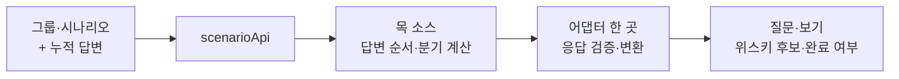
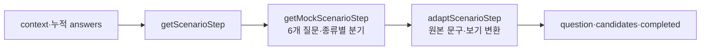
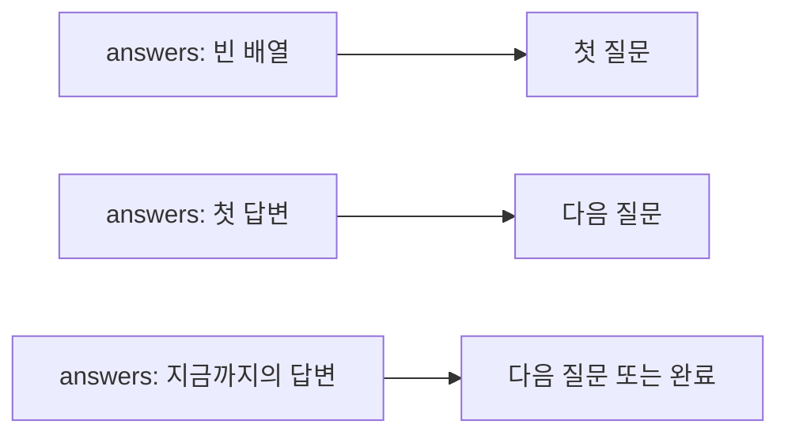
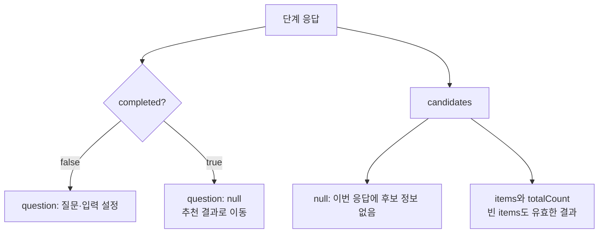
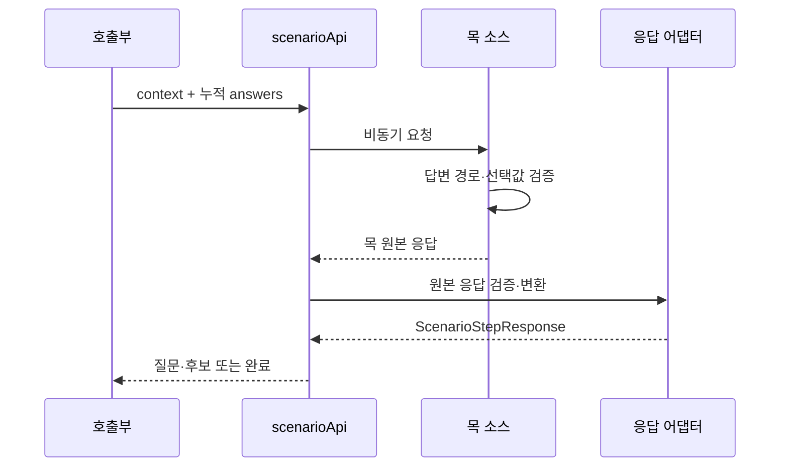

# Phase 1 — 단계 요청·응답과 목 API

> **상태:** Phase 1 구현·검토 완료 · dbd96766 커밋
>
> **기준:** 2026-10-24에 합의한 단계별 요청 흐름  
> **전제:** 아래 필드는 프론트 내부 계약이다. 실제 Product API의 주소·인증·요청·응답 계약은 미확정이다.

## 이번에 정할 것



**완료 기준:** 화면 없이도 ‘시작 → 답변 → 다음 질문 → 완료’를 목 API로 재현할 수 있다. 2026-10-24 사용자 지시에 따라 우선 정상 흐름과 화면 진행에 필수적인 입력·출력 조건만 확인한다.

## 구현 결과



| 구현                                                                                           | 결과                                                                                 |
| ---------------------------------------------------------------------------------------------- | ------------------------------------------------------------------------------------ |
| [model.ts](<../../src/app/(custom)/bartender-note/_scenario/model.ts>)                         | 객체는 interface, 종류 조합은 union. 질문·보기·답변·후보의 내부 계약                 |
| [scenarioApi.ts](<../../src/app/(custom)/bartender-note/_scenario/scenarioApi.ts>)             | getScenarioStep(request, signal?) 제공. 현재 목 호출 후 어댑터 적용                  |
| [mockScenario.ts](<../../src/app/(custom)/bartender-note/_scenario/mockScenario.ts>)           | 명시적인 테스트 context, 누적 답변 경로 검증, 일반·버번·라이 향 질문, 중간·최종 후보 |
| [adaptScenarioStep.ts](<../../src/app/(custom)/bartender-note/_scenario/adaptScenarioStep.ts>) | title → prompt, choices → options. 완료 상태·필수 정보·지원 입력 확인                |
| 기존 questionnaire.ts                                                                          | 문구·설명 유지, 보기의 고정 ID 추가. 기존 화면과 목이 공유                           |

목 context는 `{ groupId: 1, scenarioId: 1 }`이며 실제 서버 ID가 아니다. 종류 답변 전에는 candidates=null, 이후에는 종류별 fixture를 반환한다. 라이 경로는 빈 결과, 종류 상관없음은 전체 3병을 반환한다. 향·도수·가격 점수는 계산하지 않는다.

| 검증                                                   | 결과                                              |
| ------------------------------------------------------ | ------------------------------------------------- |
| 새 API 흐름·응답 경계 테스트 + 기존 바텐더 통합 테스트 | 2개 파일, 32개 테스트 통과                        |
| TypeScript 검사                                        | 통과                                              |
| 화면·브라우저                                          | 새 소스를 화면에 연결하는 Phase 3~4에서 검증 예정 |

기존 화면 테스트 실행 시 jsdom의 실제 페이지 이동 미지원 메시지가 출력됐으며 테스트는 통과했다. 실제 Product API 연동 검증은 수행하지 않았다. 다음 구현 범위는 Phase 2의 누적 답변 상태와 Query 연결이다.

| 설계 대상 | Phase 1에서 결정                                                                          |
| --------- | ----------------------------------------------------------------------------------------- |
| 입력      | 그룹·시나리오와 순서가 있는 누적 답변                                                     |
| 출력      | 지금 표시할 질문 한 개, 후보 정보, 완료 여부                                              |
| 분기      | 목 소스가 계산. 화면용 모델에 전체 이동 그래프를 전달하지 않음                            |
| 변환      | 목 원본 응답 → 화면용 모델의 단일 어댑터                                                  |
| 화면 연결 | Phase 2~4의 상세 설계에서 결정. Phase 1 구현은 기존 화면에 영향을 주지 않는 기반 코드까지 |

## 입력: 어디까지 답했는지 전달



| 입력               | 의미                                                                      |
| ------------------ | ------------------------------------------------------------------------- |
| context.groupId    | 선택한 속성 그룹 ID                                                       |
| context.scenarioId | 해당 그룹에서 실행할 시나리오 ID. slot 번호와 구분                        |
| answers            | 사용자가 답한 순서대로 questionId와 답변 값 보관. 표시 문구는 보내지 않음 |

별도의 level/likes 같은 화면 step 이름은 요청하지 않는다. 마지막 답변의 questionId와 누적 답변으로 다음 질문을 계산한다. 그룹·시나리오 ID는 호출하는 쪽에서 주입하고, 목 검증에서는 명시적인 테스트용 ID를 사용한다. 실제 그룹 목록과 시나리오 선택 규칙은 Product 계약에 맞춰 연결하며, 목록의 첫 항목이나 그룹 이름으로 대상을 추측하지 않는다.

| 답변 종류 | 저장할 값                                                        |
| --------- | ---------------------------------------------------------------- |
| 단일 보기 | choiceId                                                         |
| 숫자 범위 | min, max                                                         |
| 상관없음  | 명시적인 any. 빈 문자열로 대체하지 않음                          |
| 마셔본 술 | 선택한 alcoholIds. 빈 배열은 건너뛰기. 목에서 지원하는 임시 확장 |
| 가격      | unit과 선택 결과(choiceId 또는 any). 목에서 지원하는 임시 확장   |

## 출력: 다음에 표시할 한 화면



| 출력       | 의미                                                                     |
| ---------- | ------------------------------------------------------------------------ |
| question   | 응답 시점에 표시할 질문과 보기·입력 설정. 완료 시 null                   |
| candidates | 후보 목록과 전체 개수. 제공하지 않은 경우 null; 후보가 0개인 응답과 구분 |
| completed  | true면 종료. false면 question이 반드시 존재                              |

완료 응답에는 후보 정보를 요구한다. 추천 0개도 유효하므로 items=[], totalCount=0으로 표현한다. 중간 후보 목록이 전체 결과의 일부일 수 있어 totalCount를 items.length로 대신 계산하지 않는다.

### 프론트 내부 인터페이스

<details>
<summary>인터페이스 초안 펼치기</summary>

```ts
export interface ScenarioContext {
  groupId: number;
  scenarioId: number;
}

export interface ScenarioStepRequest {
  context: ScenarioContext;
  answers: ScenarioAnswer[];
}

export interface ScenarioAnswer {
  questionId: number;
  value: ScenarioAnswerValue;
}

export interface ScenarioStepResponse {
  question: ScenarioQuestion | null;
  candidates: ScenarioCandidates | null;
  completed: boolean;
}

export interface ScenarioQuestion {
  id: number;
  prompt: string;
  input: ScenarioInput;
}

export interface ScenarioOption {
  id: string;
  label: string;
  description?: string;
}

export interface ScenarioCandidates {
  items: ScenarioCandidate[];
  totalCount: number;
}

export interface ScenarioCandidate {
  id: number;
  name: string;
  imageUrl: string | null;
}
```

ScenarioInput과 ScenarioAnswerValue는 아래 종류별 인터페이스를 조합하는 union type으로 선언한다.

</details>

| input.kind     | 종류별 인터페이스에 포함할 설정         |
| -------------- | --------------------------------------- |
| choice         | options, allowAny                       |
| range          | min, max, step, 선택적인 unit, allowAny |
| alcohol-select | maxSelections. 현재의 최대 3병 유지     |
| price-select   | unit별 label과 options, allowAny        |

입력과 답변 값의 객체는 interface로 선언하고 종류의 조합에만 union type을 사용한다. 답변 값도 value.kind가 choice / range / any / alcohols / price인 인터페이스로 구분한다. price 값에는 unit과 selection(choice 또는 any)을 함께 둔다. 표시 문구는 답변 값에 포함하지 않는다.

## 현재 기능을 어떻게 표현할지

| 현재 질문         | 목의 입력 방식 | 분기와 보기의 출처                                |
| ----------------- | -------------- | ------------------------------------------------- |
| 경험·종류·향·도수 | choice         | 현재 문구를 공유하고 안정된 choiceId 부여         |
| 마셔본 술         | alcohol-select | 기존 술 검색 API 유지. 선택한 술 ID를 답변에 포함 |
| 가격              | price-select   | 현재 잔/병과 가격 보기를 목의 입력 설정으로 표현  |

목 소스에는 기존 6단계와 보기 분기를 재현한다. 향 질문은 일반·버번·라이에서 서로 다른 질문 ID를 사용하고, 앞선 종류 답변의 choiceId로 선택한다. 실제 Product API가 같은 6단계나 같은 입력 종류를 지원한다고 가정하지 않는다.

현행 보기 배열의 ‘상관없어요’는 목 조립 시 해당 보기의 고정 ID로 분리해 allowAny로 표현한다. 일반 options와 중복해서 표시하지 않는다. 마셔본 술의 건너뛰기는 빈 alcoholIds, 가격의 상관없음은 unit과 any 선택 결과로 표현한다.

현재 Admin 정의에서 확인한 입력은 SINGLE_CHOICE와 NUMBER_RANGE다. alcohol-select와 price-select는 기존 UX를 검증하기 위한 **프론트 목 확장**이며, 실제 연동 가능 여부는 별도 결정이다. range도 모델에 포함해 숫자 입력 계약을 표현하되, 기존 도수 보기를 숫자 슬라이더로 바꾸는 UX 변경은 이번 범위에 넣지 않는다.

후보 모델은 목록 표시를 위한 ID·이름·이미지·개수부터 정의한다. 유사 추천, 추천 이유, 가격·별점, 진행률은 서버가 제공할 의미를 확인해 후속 설계에서 확장한다. 임의의 metadata 객체에 알 수 없는 필드를 담아 화면이 직접 해석하게 하지 않는다.

## 목 API와 어댑터



| 경계        | 구체적인 동작                                                                                                                  |
| ----------- | ------------------------------------------------------------------------------------------------------------------------------ |
| scenarioApi | getScenarioStep(request, signal?)를 비동기 함수로 제공. 원본 응답을 어댑터에 한 번 통과시켜 반환                               |
| 목 소스     | 각 요청을 고정된 목 정의와 누적 답변으로 계산. 내부에 사용자별 전역 진행 상태를 저장하지 않음                                  |
| 응답 어댑터 | 목 원본 question.title → prompt, choices → 화면용 options 등 필요한 필드만 변환. 기존 BartenderQuestionnaire로 재변환하지 않음 |
| 오류        | 목이 처리할 수 없는 시나리오·답변, 표시할 수 없는 응답은 단순한 오류로 전달                                                    |
| 취소·재시도 | signal 취소 전달. 자동 지연·재시도 없음. 같은 목 정의와 같은 입력은 같은 결과                                                  |

목 계산은 답변 배열을 처음부터 따라가며 각 답변이 현재 질문에 대응하는지 확인한다. 중복·경로 밖 답변은 거절한다. 앞 답을 바꾸고 뒤 답을 정리하는 책임은 Phase 2 진행 관리에서 설계한다.

어댑터는 우선 질문 표시와 완료 판정에 필요한 필드만 확인한다. 완료 전 question 존재, 완료 시 후보 정보 존재, 지원하는 입력 종류를 검사한다. 없는 문구·후보를 임의의 기본값으로 채우지 않는다. ID 중복·숫자 제약 등 세부 검증과 오류 유형별 처리는 실제 계약 또는 재현 사례가 생기면 추가한다. 실제 HTTP 주소·인증·응답 래퍼·오류 코드는 만들지 않는다.

## 파일별 변경 범위

라우트 내부의 \_scenario/에서 시작한다.

| 파일                                                                                           | 책임                                                                              |
| ---------------------------------------------------------------------------------------------- | --------------------------------------------------------------------------------- |
| \_scenario/model.ts                                                                            | 위의 객체 interface와 입력·답변 값의 union                                        |
| \_scenario/scenarioApi.ts                                                                      | 호출부가 사용할 비동기 조회 함수. 목 호출과 어댑터 연결                           |
| \_scenario/mockScenario.ts                                                                     | 목 ID·질문·누적 답변 분기·중간/최종 후보 원본                                     |
| \_scenario/adaptScenarioStep.ts                                                                | 응답 검증과 화면용 모델 변환 한 곳                                                |
| [mockQuestionnaire.ts](<../../src/app/(custom)/bartender-note/_scenario/mockQuestionnaire.ts>) | Phase 1에서 보기 ID 보완. Phase 3에서 현재 경로로 옮겨 목 전용 문구 원본으로 사용 |

Phase 1에서는 기존 localQuestionnaire를 공유했다. Phase 3 전환에서 문구 원본을 \_scenario/mockQuestionnaire.ts로 옮기고 기존 질문지 prop과 \_data/questionnaire.ts를 제거했다. 문구를 두 파일에 복사해 보관하지 않는다.

Phase 1의 후보는 명시적인 작은 fixture로 중간 결과·0개 결과·완료를 검증한다. Phase 4도 이 작은 fixture를 사용하며, 기존 데모 점수·유사 추천 계산은 사용처를 정리한 뒤 제거하는 최소안을 제안한다. 목 후보를 실제 검색 결과나 서버 추천 품질의 근거로 취급하지 않는다.

## 구현 후 확인할 것

| 요청·조건                            | 기대 결과                                       |
| ------------------------------------ | ----------------------------------------------- |
| 빈 답변으로 시작                     | 첫 질문, completed=false                        |
| 질문에 순서대로 답변                 | 다음 질문과 중간 후보, 마지막 답변 뒤 완료      |
| 종류를 버번·라이로 선택              | 각각 알맞은 향 질문. 라이의 기존 제외 보기 유지 |
| 후보 없음 / 후보 미제공              | 빈 목록과 null을 서로 다르게 표현               |
| 필수 질문 정보 누락·모순된 완료 상태 | 화면 진행 없이 오류 전달                        |

Phase 1의 기본 진행·보기 분기·응답 변환과 타입 검사를 완료했다. 전체 화면 연결 후 Phase 3~4에서 사용자 입력부터 화면 결과까지 컴포넌트 통합 테스트와 브라우저로 확인한다. 별도 검증 프레임워크나 전체 예외 시나리오는 추가하지 않는다.

## 다음 설계와 실제 API 계약에서 정할 것

| 시점                                  | 남은 결정                                                                                            |
| ------------------------------------- | ---------------------------------------------------------------------------------------------------- |
| [Phase 2](./phase-2-scenario-flow.md) | 답변 추가·이전 질문·기본 재시도·복원. Query 데이터와 로컬 답변의 경계                                |
| Product 계약                          | 그룹 목록과 시나리오 선택, runId/버전 고정, 누적 답변 전송 방식, 질문 본문 포함 여부, 특수 입력 지원 |
| 실제 API 연결                         | 요청 필드 매핑, 주소·인증, 공유 가능한 데이터의 캐시 정책                                            |

**이번 검토의 핵심:** 입력은 context + 누적 answers, 출력은 question + candidates + completed로 잡는다. 화면은 한 질문을 받아 표시하고, 분기는 목/서버가 결정한다. 마셔본 술과 가격 입력은 목 확장으로 명시해 기존 UX를 검증한다.
