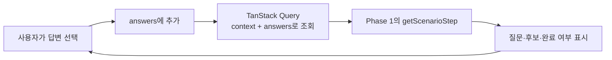
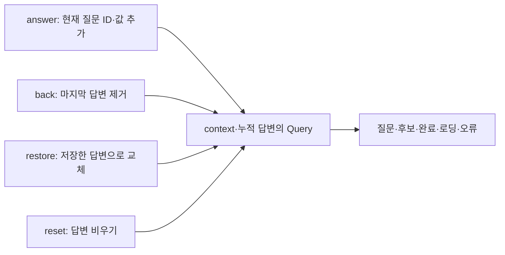
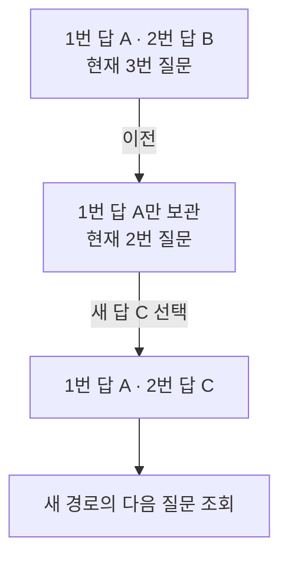
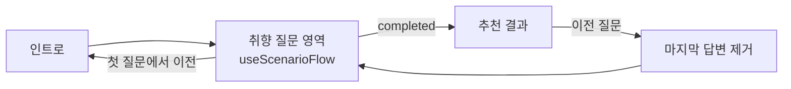

# Phase 2 — 누적 답변과 질문 진행

> **상태:** Phase 2 구현·검토 완료
>
> **선행:** [Phase 1 — 단계 요청·응답과 목 API](./phase-1-scenario-source.md) 검토 완료  
> **원칙:** 정상 흐름을 만족하는 가장 단순한 구조

## 한눈에 보기



**진행 관리에는 로컬 상태 answers 하나만 둔다.** 현재 질문·후보·완료 여부·로딩·오류는 Query 결과를 사용한다.

## 구현 결과

| 코드                                                                                                                 | 구현한 책임                                          |
| -------------------------------------------------------------------------------------------------------------------- | ---------------------------------------------------- |
| [useScenarioFlow.ts](<../../src/app/(custom)/bartender-note/_scenario/useScenarioFlow.ts>)                           | context·active를 받고 answers 하나와 단계 Query 관리 |
| [useScenarioFlow.vitest.test.tsx](<../../src/app/(custom)/bartender-note/_scenario/useScenarioFlow.vitest.test.tsx>) | 실제 목 API와 hook을 작은 소비자 화면에서 함께 검증  |



| 호출부에서 사용할 값                    | 의미                                                           |
| --------------------------------------- | -------------------------------------------------------------- |
| answers                                 | snapshot에 저장할 누적 답변                                    |
| query                                   | data·isFetching·isError 등 TanStack Query 결과                 |
| canAnswer                               | 활성 화면이고 조회·오류 상태가 아니며 현재 질문이 있을 때 true |
| canGoBack                               | answers.length > 0                                             |
| answer / back / reset / restore / retry | 아래 설계의 동작 구현. retry는 Query의 refetch 사용            |

질문 응답을 별도로 저장하는 state·요청용 effect·로컬 질문 history는 추가하지 않았다. 실제 화면·전체 여정·snapshot 연결은 Phase 3~4에서 진행한다.

**소비자 통합 테스트 5개:** 비활성→시작, 순차 답변→완료→이전 질문, 종류 변경→새 분기→초기화, 실패→같은 답변으로 재시도, 빈 Query 캐시에서 답변 복원. 실제 Product API·브라우저 검증은 화면 연결 이후 수행한다.

## 현재 코드에서 무엇이 바뀌는가

| 현재                                                                    | 제안                                                                       |
| ----------------------------------------------------------------------- | -------------------------------------------------------------------------- |
| useTasteRecommendation이 level/kind/axis 같은 답변 필드를 보관          | useScenarioFlow가 ScenarioAnswer[]를 순서대로 보관                         |
| RecommendationFlow가 답을 저장한 뒤 move('likes') 등으로 다음 단계 지정 | 현재 질문 ID와 선택값을 추가하면 API가 다음 질문을 결정                    |
| useBartenderJourney가 질문마다 step과 history를 추가                    | 전체 여정은 ‘취향 질문’ 진입 한 번만 기록. 질문 내부 이동은 answers로 처리 |
| 추천을 useMemo로 계산                                                   | Query 응답의 candidates와 completed 사용. 결과 UI 연결은 Phase 4           |

## hook이 관리할 것

| 항목                     | 저장 위치 / 계산 방법              |
| ------------------------ | ---------------------------------- |
| context                  | 그룹·시나리오 ID를 호출부에서 전달 |
| answers                  | useState의 ScenarioAnswer[]        |
| 현재 질문·후보·완료 여부 | Query의 data를 그대로 사용         |
| 로딩·오류                | Query 상태를 그대로 사용           |
| 이전 질문이 있는지       | answers.length > 0으로 계산        |

질문·후보 응답을 별도 state나 Zustand에 복제하지 않는다. 현재 질문 번호, 질문별 history, 이동 인덱스도 별도로 저장하지 않는다. 술 검색어·현재 고르는 값 같은 입력 중인 상태는 해당 입력 UI에서 관리한다.

이전 질문도 Query 캐시에서 해당 답변 배열의 응답을 활용하거나 필요하면 재조회한다. 로컬 상태에 이전 질문 목록을 따로 보관하지 않는다.

<details>
<summary>조회 부분의 구현 형태</summary>

```ts
const [answers, setAnswers] = useState<ScenarioAnswer[]>([]);

const query = useQuery({
  queryKey: [
    'bartender-note',
    'scenario-step',
    context.groupId,
    context.scenarioId,
    answers,
  ],
  queryFn: ({ signal }) => getScenarioStep({ context, answers }, signal),
  enabled: active,
  retry: false,
});
```

취향 질문에 진입하면 active=true로 조회한다. answers가 바뀌면 바뀐 입력으로 조회한다. 별도의 요청용 useEffect는 두지 않는다. 이전 질문 응답을 새 질문의 임시 데이터로 표시하는 설정도 추가하지 않는다.

Phase 4의 결과 연결에서는 active 범위를 scenario와 recommendations 두 화면으로 둔다. 같은 답변으로 받은 완료 응답을 결과에서도 사용하고, 상세에서 돌아왔을 때 캐시가 없어도 재조회하기 위한 연결이다. 결과용 Query를 따로 추가하지 않는다.

</details>

## 사용할 동작

| 동작                  | 처리                                                   |
| --------------------- | ------------------------------------------------------ |
| 시작                  | active=true, answers=[]로 첫 질문 조회                 |
| answer(value)         | 현재 Query 질문의 id와 value를 answers 끝에 추가       |
| back()                | 마지막 답변 하나 제거. 줄어든 answers로 이전 질문 조회 |
| reset()               | answers=[]                                             |
| restore(savedAnswers) | 기존 화면 복원 시 전달한 답변 배열로 교체              |
| retry()               | answers를 유지한 채 Query 재조회                       |

조회 중에는 답변 선택을 잠시 비활성화한다. 조회에 실패하면 기록을 그대로 두고 오류와 ‘다시 시도’를 표시한다. 독립적인 오류 상태나 요청 재시도 관리자는 만들지 않는다.

## 이전 질문은 ‘그 질문부터 다시 답하기’



이전 버튼을 누르는 시점에 마지막 답변을 제거한다. 돌아간 질문은 다시 선택한다. 별도로 지워 둔 답변을 보관하거나 이전 선택을 자동 복원하는 상태는 추가하지 않는다. 이 규칙이면 기존 뒤쪽 답변을 새 경로에 잘못 보내는 상황도 피할 수 있다.

## 전체 여정과 연결되는 지점



| 경계                  | 연결 규칙                                                                           |
| --------------------- | ----------------------------------------------------------------------------------- |
| 질문 안의 이전 버튼   | 답변이 있으면 flow.back(). 첫 질문이면 전체 여정의 back()                           |
| 완료 응답             | 호출부가 추천 결과 화면으로 이동. hook이 직접 라우팅하지 않음                       |
| 결과에서 이전 질문    | 마지막 답변을 먼저 제거한 뒤 질문 영역으로 복귀                                     |
| 상세에 다녀온 뒤 복원 | 기존 snapshot의 답변을 restore에 전달하고 다시 조회. 별도 저장 체계는 추가하지 않음 |

전체 여정에는 질문 영역을 나타내는 scenario step 하나를 연결하는 방향으로 잡는다. 실제 Step 타입·대사·프레임·결과 화면의 연결은 Phase 3~4에서 함께 구체화한다.

## 파일별 변경 범위

| 파일                                                                                                   | 설계한 변경                                                                                      |
| ------------------------------------------------------------------------------------------------------ | ------------------------------------------------------------------------------------------------ |
| \_scenario/useScenarioFlow.ts                                                                          | 이번 Phase의 새 hook. answers와 useQuery, 위의 동작을 한 파일에 둠                               |
| `useTasteRecommendation.ts`                                                                            | 새 진행 hook으로 답변 책임을 옮길 대상. 기존 추천·검색 표시용 로직 정리는 실제 화면 전환 때 수행 |
| [useBartenderJourney.ts](<../../src/app/(custom)/bartender-note/_components/useBartenderJourney.ts>)   | 전체 화면 이동 역할 유지. 질문 내부 history를 추가하지 않음                                      |
| [BartenderExperience.tsx](<../../src/app/(custom)/bartender-note/_components/BartenderExperience.tsx>) | Phase 3에서 hook 호출과 질문/결과 진입·복귀 연결                                                 |
| [bartenderSnapshot.ts](<../../src/app/(custom)/bartender-note/_components/bartenderSnapshot.ts>)       | 화면 전환 시 답변 필드를 새 배열로 교체하고 기존 저장·복원 경로 재사용                           |

Phase 2 기반 코드 구현은 hook 추가까지다. 기존 답변 사용처·화면·snapshot을 일부만 교체하지 않고, Phase 3~4에서 관련 사용처를 함께 연결한다.

## 구현 후 확인할 기본 흐름

| 행동                              | 기대 결과                                         |
| --------------------------------- | ------------------------------------------------- |
| 시작 후 답변을 순서대로 선택      | 누적 답변으로 다음 질문을 조회하고 완료 응답 도달 |
| 이전 질문으로 돌아가 다른 답 선택 | 마지막 답변 제거 후 새 답변으로 진행              |
| 다른 흐름에 머무르기              | 시나리오 조회 비활성화                            |
| 조회 실패 후 다시 시도            | 같은 답변으로 재조회                              |

실제 화면 연결 후 위 행동을 컴포넌트 통합 테스트와 브라우저로 확인한다. 이번 상세 설계에는 별도의 상태 머신, 진행 관리자 클래스, 버전/세션 충돌 처리, 저장 데이터 마이그레이션 설계를 추가하지 않는다.

**이번 검토의 핵심:** 진행 hook의 로컬 상태는 answers 하나다. 이전 질문은 마지막 답변을 지우고 다시 답하는 방식으로 시작한다.
