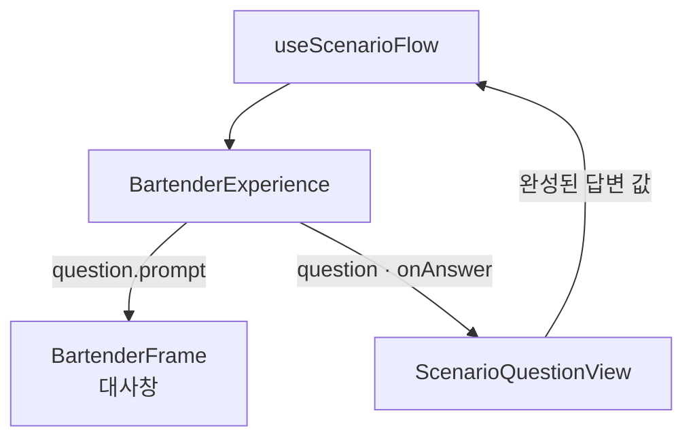
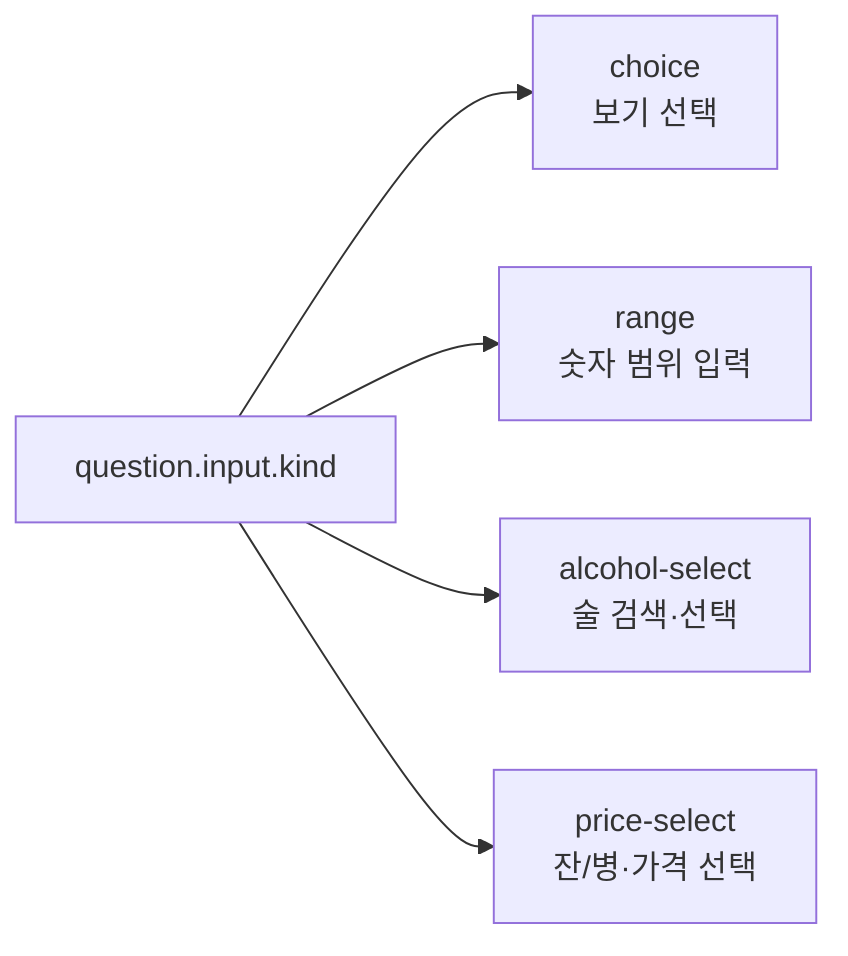
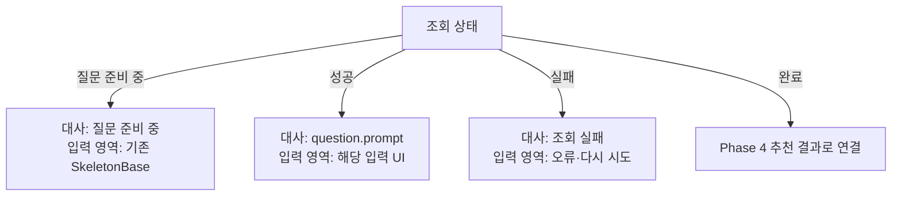
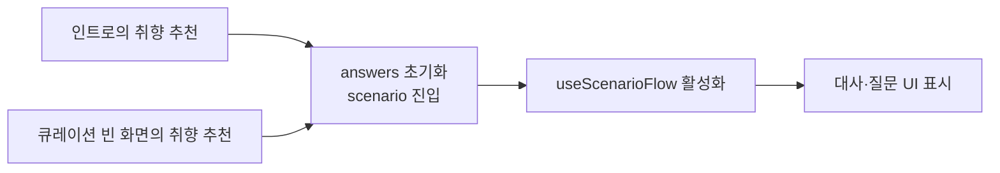

# Phase 3 — 현재 질문을 화면에 표시

> **상태:** 사용자 검토 완료 · 구현 전  
> **선행:** [Phase 1](./phase-1-scenario-source.md), [Phase 2](./phase-2-scenario-flow.md) 검토 완료  
> **목표:** 응답의 질문을 기존 대사창과 입력 UI로 표시

## 한눈에 보기

화면은 현재 질문과 답변 콜백을 받는다. 다음 질문 ID나 분기 규칙을 결정하지 않는다. 기존 RecommendationFlow를 한 질문을 표시하는 ScenarioQuestionView로 교체한다.

## 현재 코드에서 바꿀 것

| 현재                                                    | 제안                                                       |
| ------------------------------------------------------- | ---------------------------------------------------------- |
| step이 level/kind/axis인지에 따라 화면 결정             | question.input.kind에 따라 입력 UI 결정                    |
| 질문 문구는 dialogue.ts, 보기는 questionnaire.ts        | 같은 응답의 prompt와 input을 표시                          |
| 보기를 선택하면 updateAnswers와 move 호출               | 선택값을 onAnswer에 전달                                   |
| likes의 선택값과 가격 unit을 전체 답변 객체에 즉시 저장 | 입력 중인 값은 입력 UI에 보관하고 확인 시 한 답변으로 제출 |

## 입력 UI는 네 가지

| 입력 종류      | 표시와 제출                                                                                   |
| -------------- | --------------------------------------------------------------------------------------------- |
| choice         | 기존 OptionList에 id·label·description 전달. 클릭 즉시 choiceId로 답변                        |
| range          | min/max/step 설정을 적용한 숫자 입력 두 개와 ‘다음’ 버튼. 범위를 확인하고 min/max 제출        |
| alcohol-select | 기존 LikesStep의 검색·선택 UI 재사용. 최대 선택 개수는 input에서 읽고 확인 시 alcoholIds 제출 |
| price-select   | 현재처럼 잔을 기본 단위로 표시. 단위만 바꾸면 로컬 값 변경, 가격 클릭 시 unit과 choiceId 제출 |

allowAny=true이면 ‘상관없어요’를 제공한다. choice는 다른 보기와 같은 행, range는 보조 텍스트 행동, price는 현재 단위와 any 선택 결과로 제출한다. 술을 고르지 않고 건너뛰면 빈 alcoholIds를 제출한다. 기존 도수 질문은 choice를 유지한다.

필요한 입력 종류를 조건문으로 선택한다. 입력 컴포넌트 등록 시스템이나 범용 폼 생성기는 만들지 않는다. 기존 OptionList·FlowAction·Button의 크기와 스타일을 재사용한다. 숫자 입력에도 기존 입력 색상·폰트 규칙을 적용하고 필수 범위만 확인한다.

### 선택 중인 값의 위치

| 값                                   | 위치                      |
| ------------------------------------ | ------------------------- |
| 확정한 누적 답변                     | useScenarioFlow의 answers |
| 술 검색어·현재 고른 술의 ID와 표시명 | LikesStep 내부            |
| 현재 선택한 잔/병 단위               | 가격 입력 UI 내부         |
| 입력 중인 숫자 범위                  | 범위 입력 UI 내부         |

술 검색에는 기존 AlcoholsApi.lookup과 Query를 재사용한다. 초기 범위는 검색해서 고르기·선택 취소·최대 개수·건너뛰기다. 기존 데모 술 제안 칩과 숙련도에 따른 정렬은 이 흐름에 연결하지 않는다.

ScenarioQuestionView에는 question.id를 React key로 사용한다. 질문이 바뀌면 입력 중인 값이 초기화되고, 이전 질문으로 돌아오면 Phase 2에서 합의한 대로 다시 선택한다. 질문 응답 자체는 계속 Query가 관리한다.

## 대사와 조회 상태

질문 대사는 question.prompt를 그대로 사용한다. 현행 dialogue.ts의 여섯 질문 문구와 axisLine의 개인화 조립은 목 소스의 질문 문구로 대체한다. 목에서 알고 있는 이전 답변에 따른 안내는 목 소스가 prompt에 담는다. 선택한 술 이름을 프론트가 대사에 끼워 넣는 기능은 이번 최소 범위에 포함하지 않는다.

인트로·큐레이션·리뷰·결과 대사는 기존 getDialogue 흐름을 사용한다. 준비 중·실패 안내는 호출부에서 명시적인 상태 문구로 전달한다. 기존 데이터로 재조회하는 동안에는 질문을 유지하고 답변 선택을 잠시 비활성화한다. 실패 시 후보 0개나 질문 완료로 해석하지 않는다.

## 헤더와 대사 재생

| 항목                    | 결정                                                                                     |
| ----------------------- | ---------------------------------------------------------------------------------------- |
| 질문 번호               | answers.length + 1로 ‘질문 3’처럼 표시. 별도 상태 없음                                   |
| 전체 질문 수·진행률     | 현재 응답에는 총개수가 없으므로 질문 영역의 백분율 막대는 생략. 고정 6개로 계산하지 않음 |
| 바텐더 기본 자세        | scenario 단계에 기존 idle 자세 적용                                                      |
| 대사 재생·스크롤 초기화 | question.id가 바뀌는 시점에도 기존 초기화 적용                                           |

같은 scenario step 안에서 질문만 바뀌므로 BartenderFrame에 선택적인 questionId를 전달한다. 기존 대사 재생 hook과 스크롤 초기화가 이 ID도 기준으로 사용하게 한다. 프레임이나 BarScene 전체를 질문마다 다시 생성하지 않는다. 긴 대사는 현재의 타이핑·페이지 분할을 재사용한다.

## 진입과 연결

두 진입점이 같은 시작 동작을 사용한다. 전체 여정의 Step에는 scenario를 추가하고, 기존 여섯 질문 step과 질문별 history는 제거한다. 질문 내부의 이전 버튼은 Phase 2의 back을 사용하며, 첫 질문에서는 원래 진입 화면으로 돌아간다.

## 파일별 변경

| 파일                                                                                                                                                                                               | 변경                                                                                                        |
| -------------------------------------------------------------------------------------------------------------------------------------------------------------------------------------------------- | ----------------------------------------------------------------------------------------------------------- |
| [RecommendationFlow.tsx](<../../src/app/(custom)/bartender-note/_components/RecommendationFlow.tsx>)                                                                                               | ScenarioQuestionView.tsx로 교체. question과 onAnswer 중심으로 props 변경, input.kind별 UI 표시              |
| [LikesStep.tsx](<../../src/app/(custom)/bartender-note/_components/LikesStep.tsx>)                                                                                                                 | Answers·updateAnswers·likedLookups 의존 제거. 선택 중인 술을 내부에서 관리하고 IDs만 제출                   |
| [FlowControls.tsx](<../../src/app/(custom)/bartender-note/_components/FlowControls.tsx>)                                                                                                           | Option을 interface로 정의하고 선택적 id 추가. OptionList에 disabled prop 지원. 다른 사용처는 기존 호출 유지 |
| [BartenderExperience.tsx](<../../src/app/(custom)/bartender-note/_components/BartenderExperience.tsx>)                                                                                             | hook 한 번 호출. 같은 응답으로 대사·질문·조회 상태를 전달하고 진입·이전 처리 연결                           |
| [dialogue.ts](<../../src/app/(custom)/bartender-note/_components/dialogue.ts>)                                                                                                                     | 질문 문구·개인화 조립 제거. 질문 대사는 응답에서 받고 다른 단계의 기존 대사 유지                            |
| [types.ts](<../../src/app/(custom)/bartender-note/_components/types.ts>), [stepMeta.ts](<../../src/app/(custom)/bartender-note/_components/stepMeta.ts>)                                           | scenario step, 질문 번호 표시 연결. 여섯 질문 step·questionSteps와 고정 진행률 제거                         |
| [BartenderFrame.tsx](<../../src/app/(custom)/bartender-note/_components/BartenderFrame.tsx>), [useDialoguePlayback.ts](<../../src/app/(custom)/bartender-note/_components/useDialoguePlayback.ts>) | 선택적 questionId로 재생·스크롤 초기화. progress가 없으면 막대 미표시                                       |
| [CurationFlow.tsx](<../../src/app/(custom)/bartender-note/_components/CurationFlow.tsx>)                                                                                                           | 취향 추천 시작 콜백으로 연결                                                                                |
| [page.tsx](<../../src/app/(custom)/bartender-note/page.tsx>), [\_data/questionnaire.ts](<../../src/app/(custom)/bartender-note/_data/questionnaire.ts>)                                            | 질문지 prop 제거, 목 context 전달. 문구 원본을 목 소스로 옮긴 뒤 legacy 질문지 제거                         |

범위·가격 입력은 우선 질문 View 안에 둔다. 이미 별도 책임과 검색 흐름이 있는 LikesStep은 재사용한다. 컴포넌트를 입력마다 일괄 분리하지 않는다.

Phase 3의 화면 전환은 Phase 4의 추천·상세 이동·snapshot 등 기존 답변 사용처와 연결해 적용한다. 새 답변을 기존 Answers로 되돌리는 호환 어댑터는 추가하지 않는다.

## 구현 후 확인할 기본 흐름

| 사용자 행동                        | 기대 결과                                 |
| ---------------------------------- | ----------------------------------------- |
| 취향 추천 시작                     | 응답의 질문 문구와 보기가 표시            |
| 일반 보기 선택                     | 답변이 추가되고 다음 질문 표시            |
| 술 검색·선택 후 확인 또는 건너뛰기 | 선택한 IDs 또는 빈 배열 제출              |
| 잔/병 변경 후 가격 선택            | 단위와 가격을 한 답변으로 제출            |
| 숫자 범위 입력 후 확인             | min/max를 제출하고 다음 질문 표시         |
| 이전 질문으로 복귀                 | 캐시 활용 또는 재조회 후 입력을 다시 선택 |

화면 연결 후 컴포넌트 통합 테스트와 브라우저로 위 동작을 확인한다. 긴 대사, 보기 스크롤, 검색 키보드와 하단 행동 영역도 기존 모바일 레이아웃에서 확인한다. 이번에는 문서만 작성하며 제품 코드·자동 테스트·브라우저 실행은 하지 않는다.

**이번 검토의 핵심:** 응답 문구를 그대로 대사창에 표시하고, 입력 종류별 UI에서 완성한 답변만 hook에 전달한다. 총질문수 없는 현재 모델에서는 ‘질문 N’만 표시한다.
