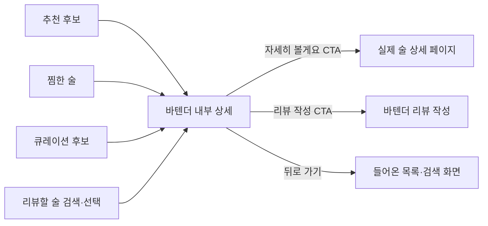
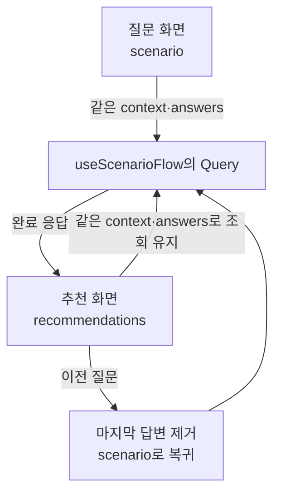
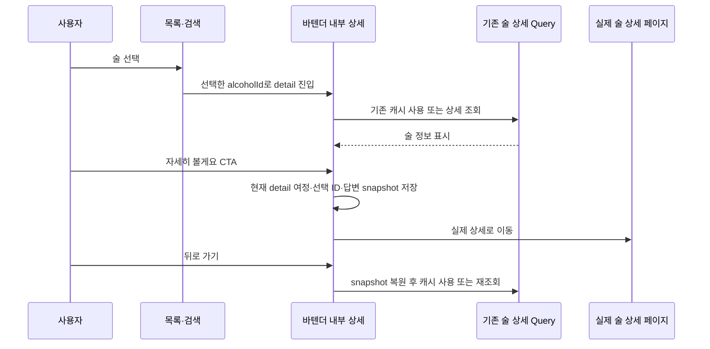

# Phase 4 — 후보·추천 결과 연결과 기존 코드 정리

> **상태:** 사용자 검토 대기 · 설계 문서만 작성  
> **선행:** Phase 1~3 검토 완료  
> **목표:** 술 선택 → 바텐더 내부 상세 → 상세 이동 또는 리뷰 작성

## 한눈에 보기

**사용자 피드백 반영:** 술을 고르면 바텐더 플로우 안에서 먼저 정보를 보여 준다. 실제 술 상세 페이지 이동은 내부 상세의 명시적인 CTA로 제공한다. 추천·찜·큐레이션·리뷰용 술 선택에 같은 기준을 적용한다.

## 현재 → 변경

| 진입 경로                   | 현재                                             | 변경                                                   |
| --------------------------- | ------------------------------------------------ | ------------------------------------------------------ |
| 추천·큐레이션 후보          | 데모 술의 내부 상세                              | 같은 내부 상세 유지. 실제 ID의 술도 표시 가능하게 연결 |
| 찜한 술                     | 데모에 있으면 내부 상세, 없으면 실제 상세로 이동 | 데모 포함 여부와 관계없이 내부 상세                    |
| 리뷰 검색·인기 술 선택      | 선택 후 바로 리뷰 방식 선택                      | 내부 상세를 먼저 표시하고 ‘리뷰 작성’으로 진행         |
| 내부 상세의 ‘자세히 볼게요’ | 실제 상세로 이동                                 | 유지. 돌아오면 내부 상세 복원                          |

## 무엇을 표시할지

| 응답 상태                 | 화면                                                       |
| ------------------------- | ---------------------------------------------------------- |
| 질문 중 candidates=null   | 후보 정보 생략                                             |
| 질문 중 후보 정보 있음    | ‘현재 후보 N병’ 한 줄. 질문 입력 영역에 목록을 펼치지 않음 |
| completed=true, 후보 있음 | 응답 순서대로 이미지·이름·내부 상세 선택 버튼 표시         |
| completed=true, 후보 0개  | 빈 결과 안내. 헤더에서 이전 질문, 하단에서 처음으로 이동   |
| 결과를 다시 조회 중       | 캐시가 있으면 결과 유지, 데이터가 없으면 로딩 표시         |
| 결과 조회 실패            | 오류·다시 시도. 후보 0개로 처리하지 않음                   |

totalCount로 전체 후보 수를 표시한다. items는 반환받은 순서대로 보여 주고, 표시 건수가 전체보다 적다면 그 수를 함께 안내한다. 목은 작은 후보 목록을 전부 반환한다. 실제 페이지 조회·더보기는 Product 계약 이후 필요한 경우 추가한다.

추천 이유·유사 후보·가격·별점은 현재 시나리오 후보 모델에 없다. 후보 목록은 이 값을 데모 데이터로 보충하지 않는다. ‘비슷한 술도 보기’와 데모 추천 이유 계산은 제거하되, **바텐더 내부 상세 화면은 유지한다.** 내부 상세에서 사용하는 술 정보는 기존 상세 API 응답 또는 기존 큐레이션 데모에서 가져오고, 제공되지 않은 가격·추천 이유는 생략한다.

## Query 결과를 끝까지 사용

useScenarioFlow의 조회는 질문 화면과 추천 결과 화면에서 활성화한다. 완료 때는 답변을 바꾸지 않고 전체 여정의 화면만 recommendations로 이동한다. 같은 Query 키를 사용하므로 결과 전용 상태나 두 번째 결과 Query를 만들 필요가 없다.

이것은 Phase 2의 연결 범위 보완이다. 결과 화면에서 돌아왔을 때 Query 캐시가 없어도 같은 답변으로 다시 결과를 받을 수 있게 한다. 다른 큐레이션·리뷰·찜 흐름에서는 시나리오 조회를 활성화하지 않는다.

추천 결과에서 이전 버튼을 누르면 마지막 답변을 제거하고 scenario 화면으로 복귀한다. 이미 완료한 답변 그대로 질문 화면에 들어가 결과로 다시 이동하는 상황을 피한다. ‘처음으로’는 답변을 비우고 바텐더 인트로로 이동한다.

## 술 선택과 외부 이동을 분리

| 영역           | 최소 설계                                                                                                                                 |
| -------------- | ----------------------------------------------------------------------------------------------------------------------------------------- |
| 후보 목록      | ScenarioCandidateList는 ID·이름·이미지를 받고 onChoose(id) 호출. 목록에서 외부 상세로 가는 Link 제거                                      |
| 선택 상태      | 기존 chosenId와 journey의 detail/history 재사용. 내부 상세 진입 자체로 snapshot을 저장하지 않음                                           |
| 실제 술 정보   | 기존 AlcoholsApi.getAlcoholDetails와 alcoholDetailKeys의 캐시 재사용. Query는 선택 ID로 조회하고 기존 상세 조회의 사용자 구분 기준을 따름 |
| 상세 표시      | WhiskeyDetail의 카드·애니메이션·하단 액션 유지. 기존 reviewAlcoholFromDetails 변환을 재사용해 데모 Whiskey 이외의 술도 표시               |
| 리뷰 검색      | ReviewPickStep이 이미 조회한 상세 캐시를 재사용. 선택 후 review-mode 대신 detail로 진입                                                   |
| 데이터 범위    | 이름·이미지·종류·지역·도수·평가·태그 중 응답에 있는 정보 표시. 기존 데모 가격은 해당 데모 경로에서만 사용                                 |
| 찜             | 내부 상세의 기존 찜 동작 재사용. 찜 목록에서는 데모 유무에 따른 외부 직행 분기 제거                                                       |
| 하단 CTA       | ‘자세히 볼게요’, ‘리뷰 작성’ 최대 2개. 찜은 카드 안의 기존 액션 유지                                                                      |
| 상세 로딩·실패 | 바텐더 프레임 안에서 로딩 또는 오류·재시도 표시. 이전 화면으로 돌아가기 가능                                                              |

기존 상세 표현과 리뷰용 술 정보 변환을 함께 사용하도록 조정한다. 새 시나리오 후보를 가짜 Whiskey로 만들거나, 상세 응답을 별도 React 상태에 복사하지 않는다. 이 상세 조회는 기존 술 API를 사용하는 것이며, 미확정인 시나리오 API 계약에 상세 필드를 추가하는 설계가 아니다.

내부 상세에서 뒤로 가면 기존 journey history를 따라 들어온 화면으로 돌아간다. 추천 결과로 돌아갈 때는 누적 답변을 유지한다. 결과 화면 자체에서 ‘이전 질문’을 눌렀을 때만 마지막 답변을 제거한다. 리뷰 검색에서 들어왔다면 뒤로 가기는 리뷰 검색으로, ‘리뷰 작성’은 기존 review-mode로 이어진다.

외부 이동은 내부 상세의 Link와 ROUTES.ALCOHOL.DETAIL(id)로 처리한다. 리뷰 저장 완료 화면의 기존 ‘작성한 리뷰 보기’ CTA는 별도 리뷰 상세 이동으로 유지한다.

## 기존 snapshot에 최소 정보만

| 저장할 것                                | 저장하지 않을 것 |
| ---------------------------------------- | ---------------- |
| 전체 여정의 step과 history, 선택한 술 ID | 질문 응답 목록   |
| scenario의 context와 누적 answers        | 위스키 후보 응답 |
| 다른 리뷰·큐레이션 흐름의 기존 상태      | Query 캐시 사본  |

기존 snapshot의 answers/likedLookups 필드를 scenario의 context와 answers로 교체한다. 선택 중인 술 이름은 Phase 3 입력 UI에서만 사용하므로 최상위 likedLookups는 제거한다. 같은 sessionStorage 저장 경로와 30분 복원 기준을 재사용한다. 저장 키만 새 버전으로 구분해 이전 임시 형식과 섞이지 않게 한다.

복원된 화면이 detail이면 선택 ID로 내부 상세 정보를 다시 조회하고, 내부 뒤로 가기를 누르면 저장된 history로 복귀한다. recommendations로 돌아왔을 때 저장한 답변으로 시나리오 Query를 활성화한다. 다른 화면의 리뷰 초안 등 기존 필드는 해당 흐름을 위해 유지한다. 상세 API 응답은 snapshot에 새로 복제하지 않는다.

## 데모 추천과 함께 정리할 코드

| 현재                                                       | 정리 방향                                                             |
| ---------------------------------------------------------- | --------------------------------------------------------------------- |
| useTasteRecommendation의 answers·추천 계산·baseWhiskeyName | useScenarioFlow와 응답 표시로 대체한 뒤 hook 제거                     |
| CandidateList의 exact/similar 분기와 조건 요약             | 취향 추천 부분 제거. 큐레이션·찜 목록 역할만 유지                     |
| favorites가 answers.unit에 의존                            | 기존 초기값인 glass를 찜 목록의 표시 기본값으로 두어 취향 답변과 분리 |
| Step의 여섯 질문과 similar                                 | scenario 질문 영역과 recommendations 결과로 정리                      |
| 데모 점수·추천 이유·유사 후보 계산                         | 새 목에 이식하지 않고 사용처가 없어진 demoSelection.ts 제거           |
| 데모 술·큐레이션 데이터                                    | 다른 큐레이션·찜·리뷰 흐름의 사용 범위에서 유지                       |

단순성을 우선해 목의 후보는 Phase 1의 작은 fixture로 재현한다. ‘기존 데모 추천 계산을 목으로 옮긴다’는 초기 계획은 이식 없이 정리하는 것으로 단순화한다. 목은 질문 분기와 중간/최종 후보 응답을 재현하는 데 필요한 정도만 갖는다.

## 결과 추적의 최소 변경

기존 bottle-note-ga4 스킬과 이벤트 호출부를 기준으로 설계한다. 실제 측정 코드 변경은 구현 단계에서 수행한다.

| 기존 이벤트                 | 새 흐름에서의 연결                                                                                 |
| --------------------------- | -------------------------------------------------------------------------------------------------- |
| bartender_recommend_result  | 완료한 결과가 성공적으로 표시될 때 전송. 새 후보 응답은 available/empty로 구분하도록 타입 확장     |
| bartender_select_alcohol    | 추천·큐레이션·찜에서 내부 상세를 여는 선택 시 alcohol_id와 기존 source(taste/situation/picks) 전송 |
| bartender_open_alcohol_page | 내부 상세의 ‘자세히 볼게요’ CTA에서만 전송. 기존 source=detail 유지                                |

기존 이벤트 이름과 매개변수 키를 재사용한다. GTM 설정에는 값 목록 제한이 없으므로 새 이벤트나 매개변수 키를 추가하지 않는다. 과거 exact/similar와 기존 큐레이션 값은 타입에서 유지하고, 새 후보를 근거 없이 exact로 분류하지 않는다.

같은 결과의 Query 재조회로 이벤트를 반복 전송하지 않도록 기존 lastResult ref를 사용한다. 결과의 키는 context와 answers로 계산한다. 추천 결과 또는 그 결과에서 들어간 내부 상세의 snapshot을 복원할 때는 같은 키로 ref를 초기화하고, 처음부터 다시 시작할 때 비운다. 답변 원문·검색어·선택 배열 자체는 이벤트에 보내지 않는다.

## 파일별 변경

| 파일                                                                                                                                                                                                                                     | 변경                                                                                         |
| ---------------------------------------------------------------------------------------------------------------------------------------------------------------------------------------------------------------------------------------- | -------------------------------------------------------------------------------------------- |
| \_components/ScenarioCandidateList.tsx                                                                                                                                                                                                   | 새 후보 목록·빈 결과·내부 상세 선택 버튼 표시                                                |
| [BartenderExperience.tsx](<../../src/app/(custom)/bartender-note/_components/BartenderExperience.tsx>)                                                                                                                                   | 후보 수·최종 결과 표시. 모든 술 선택을 detail로 연결, 선택 ID 기준 조회·외부 이동·복원 연결  |
| [CandidateList.tsx](<../../src/app/(custom)/bartender-note/_components/CandidateList.tsx>)                                                                                                                                               | 취향 추천 분기와 DemoRecommendation/Answers 의존 제거. 찜 목록의 외부 상세 직행 제거         |
| [WhiskeyDetail.tsx](<../../src/app/(custom)/bartender-note/_components/WhiskeyDetail.tsx>), [reviewAlcohol.ts](<../../src/app/(custom)/bartender-note/_components/reviewAlcohol.ts>)                                                     | 기존 내부 상세가 실제 API 정보도 표시하도록 입력·변환 재사용. 실제 이미지와 선택적 필드 처리 |
| [ReviewPickStep.tsx](<../../src/app/(custom)/bartender-note/_components/ReviewPickStep.tsx>), [ReviewFlow.tsx](<../../src/app/(custom)/bartender-note/_components/ReviewFlow.tsx>)                                                       | 기존 검색·상세 캐시 재사용, 선택 후 내부 상세를 거쳐 리뷰 작성                               |
| [useTasteRecommendation.ts](<../../src/app/(custom)/bartender-note/_components/useTasteRecommendation.ts>), [\_data/demoSelection.ts](<../../src/app/(custom)/bartender-note/_data/demoSelection.ts>)                                    | 사용처 제거 후 삭제                                                                          |
| [types.ts](<../../src/app/(custom)/bartender-note/_components/types.ts>), [stepMeta.ts](<../../src/app/(custom)/bartender-note/_components/stepMeta.ts>), [dialogue.ts](<../../src/app/(custom)/bartender-note/_components/dialogue.ts>) | 과거 질문·similar·데모 추천 이유 의존 제거. 결과 대사는 후보 수 기준                         |
| [bartenderSnapshot.ts](<../../src/app/(custom)/bartender-note/_components/bartenderSnapshot.ts>)                                                                                                                                         | 시나리오 context·answers 저장·복원, 불필요한 likedLookups 제거                               |
| [useTrackRecommendResult.ts](<../../src/app/(custom)/bartender-note/_components/useTrackRecommendResult.ts>), [analytics/types.ts](../../src/utils/analytics/types.ts)                                                                   | 새 답변·후보 결과 기준으로 기존 이벤트 호출부와 허용 값 조정                                 |
| [BartenderExperience.vitest.test.tsx](<../../src/app/(custom)/bartender-note/_components/BartenderExperience.vitest.test.tsx>)                                                                                                           | 새 목 요청·화면 흐름에 맞춰 취향 추천 시나리오 교체. 다른 흐름 회귀 확인                     |

Phase 1~2 기반 코드 위에서 Phase 3 화면과 이 Phase의 기존 답변 사용처를 함께 전환한다. 기존 Answers를 새 답변과 동시에 유지하거나 두 모델 사이의 임시 호환 어댑터를 만들지 않는다.

## 구현 후 확인할 기본 흐름

| 사용자 행동                | 기대 결과                                               |
| -------------------------- | ------------------------------------------------------- |
| 질문에 순서대로 답변       | 중간 후보 수, 완료 후 응답의 후보 목록 표시             |
| 추천·찜·큐레이션의 술 선택 | 바텐더 내부 상세 표시. 목록 선택으로 외부 이동하지 않음 |
| 리뷰 검색에서 술 선택      | 내부 상세 → 리뷰 작성 CTA → 기존 작성 흐름              |
| 내부 상세에서 뒤로 가기    | 들어온 목록·검색으로 복귀. 추천 답변은 유지             |
| 자세히 볼게요 CTA          | 해당 ID의 실제 상세 페이지로 이동                       |
| 실제 상세에서 돌아오기     | 바텐더 내부 상세 복원. 내부 뒤로 가기로 원래 목록 복귀  |
| 결과에서 이전 질문         | 마지막 답변 제거 후 다시 답하기                         |
| 후보가 없는 완료 응답      | 빈 결과 안내, 이전 질문·처음으로 이동 가능              |
| 내부 상세에서 찜·리뷰 작성 | 기존 API 동작 유지, 바텐더 안에서 진행                  |

구현 후 타입 검사와 바텐더 컴포넌트 통합 테스트를 실행한다. 브라우저에서는 질문 완료·내부 상세·외부 상세 이동·복귀와 찜·리뷰 검색 경로를 확인하고, 관련 GA4 이벤트의 조건과 값도 점검한다. 목 응답 검증과 실제 Product API 연동 검증은 구분한다. 이 문서 작성에서는 제품 코드·테스트·브라우저·외부 GTM 설정을 변경하지 않는다.

**반영한 결정:** 추천·찜·큐레이션·리뷰에서 고른 술은 바텐더 내부 상세로 통일한다. 실제 상세는 명시적인 CTA로 이동하고, 리뷰 작성도 바텐더 내부에서 이어 간다. 중간 후보 수·최종 후보 목록과 누적 답변 구조는 기존 설계대로 유지한다.
