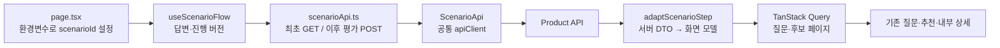
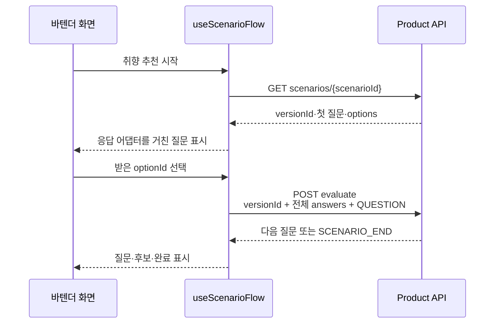
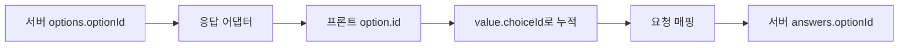
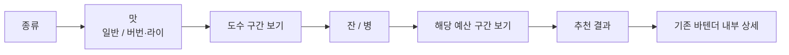

# Product 시나리오 API 연결 대조

> **확인일:** 2026-10-25
>
> **상태:** 실제 GET·평가 POST 연결 완료. 버전 고정·복원·결과 다음 페이지 지원.

## 결론

**현재의 화면 → 진행 hook → API → 응답 어댑터 구조로 연결할 수 있다.** 원본 응답과 요청은 실제 `optionId` 계약에 맞추되, 프론트의 `option.id`·`value.choiceId`는 재사용할 수 있다. 버전·결과 페이징·보기별 선택 상태는 모델과 진행/UI에 보완한다.

| 근거        | 확인 대상                                                                                                       |
| ----------- | --------------------------------------------------------------------------------------------------------------- |
| 프론트 데모 | [PR #897](https://github.com/bottle-note/bottle-note-frontend/pull/897), head `899076c`                         |
| 백엔드 계약 | [PR #812](https://github.com/bottle-note/bottle-note-api-server/pull/812), 병합 완료                            |
| 실제 문서   | [Product OpenAPI](https://docs.bottle-note.com/openapi.product.json), 캐시 우회 조회에서 시나리오 경로 2개 확인 |
| 실행 확인   | 현재 로컬 FE의 개발 API 프록시로 GET·무상태 평가 POST·결과 다음 페이지 호출                                     |

공개 문서 JSON의 기본 URL은 처음에 81개 경로만 반환했다. 새 쿼리로 캐시를 우회한 응답에서는 83개 경로와 시나리오 스키마가 확인됐다. 아래는 이 최신 계약과 실제 응답 기준이다.

## 실제 API 연결 구현



| 변경                       | 결과                                                                                                   |
| -------------------------- | ------------------------------------------------------------------------------------------------------ |
| `src/api/scenario/`        | 실제 DTO와 공개 GET·평가 POST. AbortSignal·오류 상태 전달                                              |
| `_scenario/scenarioApi.ts` | 최초 GET, 이후 versionId·누적 questionId/optionId로 QUESTION 평가. 더 보기는 RESULT·cursor             |
| `adaptScenarioStep.ts`     | 기존 choice 모델 유지. 서버 보기 ID·후보 수·비활성·완료·버전·다음 cursor 변환                          |
| `useScenarioFlow.ts`       | 답변·버전만 로컬 보관. useInfiniteQuery로 질문·결과 페이지 관리. 이전 답변 변경 시 이후 기록 폐기      |
| 세션 복원                  | 상세 방문 시 versionId와 답변 저장. snapshot v3로 이전 목 세션과 구분                                  |
| 오류·더 보기               | 버전 409는 처음부터 시작 안내. 다음 페이지 실패는 기존 목록을 유지하고 재시도                          |
| 목 제거                    | mockScenario.ts·mockQuestionnaire.ts 제거. 응답 대역은 테스트의 `__fixtures__/scenario.ts`에만 존재    |
| 진입 설정                  | `BARTENDER_SCENARIO_ID`로 설정. 미설정 시 실제 개발 서버에서 확인한 시나리오 3 사용. 가짜 groupId 제거 |

질문별 Query 키에 scenarioId·versionId·누적 답변을 포함한다. 진행 중에는 자동 갱신으로 서명된 보기가 교체되지 않게 하고, 처음부터 시작하면 최초 조회 캐시를 초기화한다. 응답 전체를 프론트 서버 공용 캐시로 고정하지 않는다.

## 확정된 호출 계약

| 호출                                           | 역할                                                           |
| ---------------------------------------------- | -------------------------------------------------------------- |
| `GET /api/v1/scenarios/{scenarioId}`           | 현재 게시 버전·첫 질문·보기·후보 수                            |
| `POST /api/v1/scenarios/{scenarioId}/evaluate` | `versionId`, 누적 `answers`, `mode`로 다음 질문 또는 결과 계산 |
| 평가의 `cursor`, `size`                        | 결과 keyset 페이징. 기본 20개, 최대 100개                      |

- 로그인 없이 두 API를 사용할 수 있다. 결과 조회도 익명 호출에서 200을 확인했다.
- 실제 결과는 공통 응답의 `data` 안에 있다.
- 실행·답변·결과를 서버에 저장하지 않는 평가 API다. 캠페인 참여 이벤트는 별도다.
- Product에서 확인한 시나리오 경로는 위 2개다. 그룹 목록을 먼저 조회하는 호출은 이 실행 계약에 없다.



## 기존 설계 → 실제 계약

| 현재 목 설계                     | 실제 API                                       | 프론트 조정                                                               |
| -------------------------------- | ---------------------------------------------- | ------------------------------------------------------------------------- |
| context에 groupId·scenarioId     | URL에는 scenarioId, 평가에는 versionId         | groupId 제거. 시작 응답의 버전을 진행·복원 정보에 보관                    |
| `{ questionId, value }`          | `{ questionId, optionId }`                     | 프론트 value.choiceId에 서버 optionId 저장. 요청 경계에서 optionId로 매핑 |
| choice·range·any 등 답변 값 분기 | CHOICE·NUMBER_RANGE·ANY 모두 optionId 제출     | 실제 질문을 choice로 변환. 기존 choice 답변 경로 재사용                   |
| 도수 숫자 직접 입력              | 서버가 숫자 구간 보기 생성                     | 서버 label 표시. min/max 직접 입력·전송하지 않음                          |
| 잔/병과 가격을 한 질문에서 제출  | 잔/병 질문 뒤 해당 가격 질문으로 분기          | 별도 프론트 가격 단위 상태 없이 받은 질문을 순서대로 표시                 |
| allowAny로 ‘상관없어요’ 생성     | ANY 보기가 이미 options 안에 있음              | 내려온 보기 그대로 표시하고 중복 생성 제거                                |
| 보기의 ID·문구                   | optionId·label·candidateCount·selectable       | 보기별 후보 수와 비활성 상태 지원                                         |
| completed boolean                | QUESTION / USER_FINISHED / SCENARIO_END        | state를 화면용 완료 여부로 변환                                           |
| 후보 items·totalCount            | candidateCount + candidates.content·pagination | 기존 목록 모델로 변환하고 다음 페이지 조회 추가                           |

`optionId`는 시나리오·버전·질문·선행 답변·선택 조건에 연결된 서버 서명값이다. 프론트는 해석하거나 새로 만들지 않는다. `ANY`도 서버가 준 ID를 보관한다.

### 내부 답변 모델은 유지할 수 있다



- CHOICE·NUMBER_RANGE·ANY 보기를 모두 `input.kind=choice`와 명시적인 options로 변환한다.
- 기존 `value.kind=choice, choiceId=option.id` 제출 경로를 사용한다. `optionId`는 문자열 그대로 유지된다.
- 서버의 ANY도 명시적인 보기로 전달하고 `allowAny=false`로 두면, UI에서 별도 ‘상관없어요’를 만들지 않는다.
- 숫자 구간과 잔/병·가격은 서버가 별도 질문·보기로 제공하므로 기존 choice 화면으로 표시할 수 있다.
- 앞서 제안한 내부 답변 전체를 `{questionId, optionId}`로 바꾸는 작업은 필수가 아니다. 그 형태는 HTTP 요청 DTO에서 사용한다.

```ts
interface ScenarioProgress {
  versionId: number | null;
  answers: ScenarioAnswer[]; // 기존 questionId + value.choiceId 사용
}
```

versionId는 시작한 게시본을 가리키는 요청 정보다. 질문·후보 응답은 계속 Query에 두고, 로컬에 질문 history나 응답 사본을 추가하지 않는다. 이전 질문은 기존처럼 마지막 답변을 제거한 배열로 조회하면 된다. 이 최소 흐름에는 `viewQuestionId`가 필수는 아니다.

## 어댑터의 변경 격리 범위

| 변경                                                            | 처리 위치                                 | 화면에 미치는 영향                      |
| --------------------------------------------------------------- | ----------------------------------------- | --------------------------------------- |
| questionId → id, title → prompt                                 | 응답 어댑터                               | 기존 대사·질문 UI 유지                  |
| optionId → option.id, 서버 options → choice options             | 응답 어댑터                               | 기존 choice 클릭·누적 답변 재사용       |
| state → completed, content → items, candidateCount → totalCount | 응답 어댑터                               | 기존 완료 전환·목록·내부 상세 선택 유지 |
| value.choiceId → 요청 optionId, GET/POST 구분                   | scenarioApi의 요청 경계                   | 화면은 getScenarioStep 호출 유지        |
| versionId 보관·복원                                             | model·useScenarioFlow·snapshot·호출부     | 답변 흐름 유지, 요청 버전 추가          |
| selectable → disabled, 후보 수 설명                             | 모델 보완·ScenarioQuestionView·OptionList | 보기별 비활성 속성 전달과 후보 수 표시  |
| cursor 기반 더 보기                                             | 후보 모델·진행 hook·ScenarioCandidateList | 다음 페이지를 가져오는 행동 추가        |

### 연결 결과

- 응답 어댑터는 실제 서버 DTO만 참조한다. 목 소스는 제품 호출 경로에서 제거했다.
- versionId는 진행 정보와 Query 키·상세 복원에 전달한다.
- 보기별 disabled와 후보 수를 기존 choice UI에 전달한다.
- 결과 cursor는 후보 모델과 useInfiniteQuery에서 사용한다. 어댑터는 다음 페이지를 요청하지 않는다.

**범위 판단:** 응답 필드명·배열 구조·완료 상태 변환은 어댑터에 모을 수 있다. 이번 실제 계약에는 요청 버전과 페이징, 보기별 비활성이라는 추가 동작이 있어 여러 파일의 연결 수정이 필요하다. 질문 프레임·애니메이션·대사 재생·내부 상세·리뷰 저장 흐름을 다시 설계할 필요는 없다.

## 현재 개발 데이터에서 확인한 화면 흐름



| 실행 확인           | 결과                                                                                         |
| ------------------- | -------------------------------------------------------------------------------------------- |
| 현재 데모 설정      | PR 최신 기본값은 scenarioId=3. 실제 GET은 versionId=3, 초기 후보 675병                       |
| PR 본문의 예전 설정 | scenarioId=1은 현재 404. 본문의 그룹 7·시나리오 1·50병 기록과 현재 코드·데이터를 구분해야 함 |
| 싱글 몰트 경로      | 질문 11 → 12 → 14 → 15 → 16 → SCENARIO_END. 실제 보기 선택으로 결과 11병 확인                |
| 버번·병 경로        | 질문 11 → 13 → 14 → 15 → 17 → SCENARIO_END. 맛·예산 분기는 서버에서 결정                     |
| 선택 불가 보기      | 첫 질문의 ‘기타’는 candidateCount=0, selectable=false                                        |
| 중간 응답           | 후보 수는 있지만 candidates.content는 빈 배열. 질문 중에는 수만 표시 가능                    |
| 중간 결과 보기      | mode=RESULT, answers=[]로 USER_FINISHED·후보 675병·첫 페이지 20개. 익명 200                  |
| 결과 페이징         | nextCursor로 두 번째 20개 조회, 첫 페이지와 중복 ID 없음                                     |

위 ID·개수·질문 구성은 확인 시점의 개발 데이터다. 버전·후보 수·질문 순서를 화면 코드에 고정하지 않는다. API 평가 호출은 이벤트나 리뷰·찜을 저장하지 않는다.

## 무엇을 재사용하고 무엇을 조정할지

| 영역                                | 연결 범위                                                                    |
| ----------------------------------- | ---------------------------------------------------------------------------- |
| `src/api/scenario/scenario.api.ts`  | PR #897의 GET·POST 호출 방식 참고. 프로젝트의 interface·응답 검증 규칙 적용  |
| `_scenario/model.ts`                | 기존 choice 답변 형태 유지. versionId·보기 상태·pagination 반영              |
| `_scenario/scenarioApi.ts`          | 첫 조회는 GET, 이후에는 현재 버전과 누적 답변으로 평가                       |
| `_scenario/adaptScenarioStep.ts`    | 원본 응답을 기존 화면 모델로 바꾸는 한 곳 유지                               |
| `_scenario/useScenarioFlow.ts`      | 누적 답변·이전·재시도·복원 유지. 요청 버전과 결과 cursor 처리 추가           |
| `ScenarioQuestionView`·`OptionList` | 실제 서버 보기 표시, 보기별 후보 수·disabled 반영. 실제 응답은 choice로 표시 |
| `ScenarioCandidateList`·snapshot    | 후보 더 보기와 요청 버전 복원 연결                                           |
| 내부 상세·리뷰 CTA                  | 현재 합의한 바텐더 내부 상세 경유 유지                                       |

### 최초 연결에서 적용할 기준

- 기본 진행은 `mode=QUESTION`으로 다음 질문을 받고 자연 종료한다. ‘바로 추천받기’는 `mode=RESULT`를 쓰는 추가 UX다.
- `409` 게시 버전 충돌은 첫 조회부터 다시 시작하도록 안내한다. 선택지 오류와 커서 만료도 응답 계약에 맞춰 처리한다.
- 기존 Query 캐시는 유지한다. 보기·후보가 선행 답변과 현재 DB에 따라 달라지므로, 질문 응답 전체를 공용 서버 캐시로 고정하지 않는다.
- PR 데모의 네 번째 진입점·별도 Local Storage 세션·로그인 후 결과 표시·캠페인은 추가 화면 정책이다. 이번 최소 연결은 현재 취향 추천 진입과 내부 상세 UX를 기준으로 한다.

## 검증 범위

- API 확인: 최신 PR 코드·Product OpenAPI, 개발 GET·전체 답변 평가·두 분기 완료·익명 중간 결과·2페이지 조회.
- 실제 브라우저: 390×844에서 서버 질문·후보 675병, 이전 질문의 종류 변경, 버번·병 5개 답변으로 추천 91병 확인. 더 보기 POST로 목록 20→40병 확인.
- 상세·복원: 실제 후보 121의 내부 상세 → `/alcohols/121` → 뒤로 가기로 내부 상세·40병 목록 복귀. snapshot의 시나리오 3·버전 3·답변 5개 유지 확인.
- 360×640: 이전 예산 질문 복귀, 내부 영역 스크롤 확인. 문서 높이 640px·가로 넘침 없음. 기존 비로그인 세션 조회 401 외 시나리오 요청 오류 없음.
- 자동 검증: 관련 테스트 48개 통과. 버전 고정·누적 답변 전송·복원·이전 질문 변경·409 재시작·페이지 실패 후 재시도 포함. 타입 검사·변경 제품 코드 ESLint 통과.
- 실제 서버의 버전 게시 충돌·커서 만료는 강제로 재현하지 않았다. 409 화면 처리는 API 응답 대역으로 검증했다.
- 저장소 변경: DTO·실제 HTTP 연결·어댑터·진행 버전·복원·결과 페이징·목 제거와 관련 테스트. 브랜치 전환·PR 병합·공유 프리뷰 변경은 수행하지 않음.
